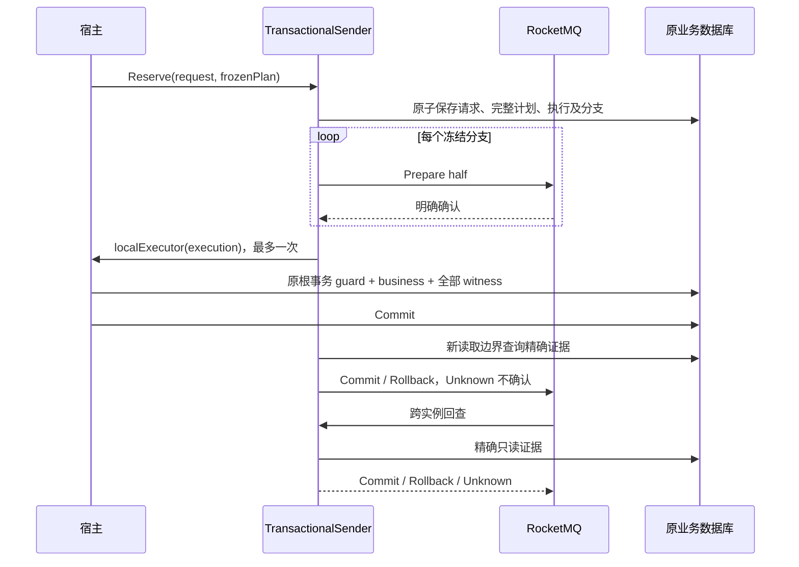

# RocketMQ 事务 SDK

Go/Python 提供嵌入式 `TransactionalSender`，以原业务事务中的精确 witness 决定消息提交。宿主持有数据库连接、根事务、事件循环、运行生命周期及业务重试许可。本批候选版本为 Go `v0.5.0-rocketmq-tx.1`、Python `0.4.0a1`；发布与验证状态以[发布索引](../releases/README.md)为准，不能从源码版本推断已发布或生产采用。

本页是事务消息契约的唯一接入正文。旧[Outbox](../01-核心设计/事务与Outbox.md)与普通 `Publisher` 保持独立；事务证据没有旧 Outbox 状态机、Relay 或自动清理。业务迁移属于 M3，M2 不修改任何宿主或生产 provider。

## 原事务与发送次序

1. 以 owner、scope、幂等键及稳定业务 input hash 查询/竞争 `Reserve`。原子保存完整计划与执行；相同输入返回赢家首次 ID、时间、wire、路由和摘要。首次生成的新密文不参与业务输入冲突判断。重复请求不带执行 token，不能自动 `Execute`。
2. `Execute` 仅消费一次持久化执行资格。每分支独立半消息，只有全部明确 Prepared 才调用一次宿主 `localExecutor`。半消息失败/Unknown 不启动本地业务；已准备分支依靠持久化中止证据收敛。
3. 宿主开启原业务根事务，第一步 `Bind` 竞争 execution guard，写业务事实，再 `CommitWitness` 写全部分支及 execution Committed，最后宿主提交根事务。SDK 不替宿主另开/提交业务事务。
4. SDK 使用新权威读取边界核对所有精确 witness，再发送 Broker Commit/Rollback。不确定保持 Unknown；回调返回 nil、半消息确认或某业务行存在都不能替代证明。
5. 原进程退出后，任何配置相同 owner、数据库绑定、epoch、全部路由的空闲实例 `Start` 后可承担真实 Broker 回查。Checker 和中止器不重做业务、不重新发送半消息。

## 三阶段与错误处理

| 阶段 | 结果 | 处理原则 |
| --- | --- | --- |
| Half | NotAttempted / Prepared / Rejected / Unknown | 任一非 Prepared，不执行业务 |
| Local | NotStarted / Committed / Aborted / Unknown | 由原事务证据决定；不能从网络错误猜回滚 |
| Final | NotAttempted / CommitConfirmed / RollbackConfirmed / Unknown | 独立 Broker 确认结果，不代表消费者完成 |

Go 同时检查返回的 `transaction.Result` 和 error；Python 捕获 `TransactionSendError` 后检查 `.result`。`LocalCommitted + FinalUnknown` 是合法状态，不能重做业务或换 ID 补发。取消、关闭超时和 lease 到期本身均不是 Rollback 证明。部分准备或崩溃仍保留原分支身份和未知 Broker ID；不能捏造确认信息。

`Store.Lookup` 返回原计划/执行状态。重试同计划的新 fence 或重建新计划必须由宿主调用明确的 `AuthorizedStore.Retry` / `Replan` 接口（Python 对应 `retry` / `replan`），并先证明旧 execution/全部分支 Aborted。新计划代次必须使用新 operation；旧计划/执行/终态永久保留，本批没有证据 GC。fence 为 `1..2^63-1`，身份按原 UTF-8 bytes 精确比较，首次 wire 直接保存 bytes，不经 JSON 重建或重新签名/加密。

## 存储安装与适配矩阵

| 适配 | 借用边界 | 示例/实现 |
| --- | --- | --- |
| Go MySQL `database/sql` | 原 `*sql.Tx`；条件写入与行锁保护 execution | [可编译 SQL 示例](../../examples/rocketmq-transaction/host.go)、[适配包](../../storage/transaction/mysql) |
| Go GORM | 活动根事务的原 SQL transaction；拒绝普通 handle/未知包装 | 同一示例的 `ExecuteGORM`；不能从外层嵌套 savepoint 冒充根提交 |
| Go MongoDB | 同 client/database 的活跃原 session；条件写入/写冲突 | 同一示例的 `ExecuteMongo`、[适配包](../../storage/transaction/mongo) |
| Python SQLAlchemy/MySQL | 原 AsyncSession/AsyncConnection 根事务 | [Python 示例](../../python/examples/rocketmq_transaction.py)、[适配](../../python/src/reliable_messaging/transaction_mysql.py) |

Python Mongo 不在本批。SQLAlchemy 拒绝 AUTOCOMMIT、嵌套/外部加入事务、绑定替换和结束后的 guard；savepoint release 不代表根提交。Mongo `WithTransaction` 的纯数据库 callback 可重入，每次重新 Bind；冻结消息、半消息发送、签名、加密、外部 HTTP/模型调用必须在 callback 外。SDK executor 本身不重复调用。

MySQL [schema.sql](../../storage/transaction/mysql/schema.sql)与 Python 包内同一模板需宿主显式安装；Mongo `InstallSchema`/索引同样需显式调用。`rm_tx_binding` 校验 owner、store_id、writer_epoch、schema_version；构造和 Start 不执行 DDL。已有 schema 版本不匹配会拒绝，不能用 `CREATE TABLE IF NOT EXISTS` 当升级。使用独立于旧 Outbox 的四类模型：request、冻结 plan、execution、精确 branch witness。Go/Python MySQL 可互读同一协议，Broker message/transaction ID 与原业务 message ID 分开持久化。

业务 guard 与中止器竞争同一 execution。中止只在条件成立时提交 Aborted；lease 到期只是尝试中止的资格。已提交 Aborted 会阻止迟到业务事务提交。Checker 只在精确 execution 与 branch 均 Committed 时 Commit、均 Aborted 时 Rollback；缺失、Prepared、owner/epoch/fence/hash 冲突、数据库错误/超时、矛盾证据均 Unknown。

## v2 路由与权限

Go `transport.PhysicalTopicV2` / Python `physical_topic_v2` 采用相同长度前缀 UTF-8 编码，输入 logical topic、NORMAL/TRANSACTION、owner、route revision。[规范向量](../../contracts/rocketmq-routing-v2.json)与 infra 相同。NORMAL 与 TRANSACTION 永远不同物理 Topic，不原地修改旧 Topic 类型。事务配置必须与规范物理名、owner、revision 一致。

回查 Reference 位于受限协议 metadata，保留原正文 bytes；Checker 同时校验实际 Topic、原正文 hash、数据库精确证据。消息属性不能选择数据库连接。Reference 上限 8192 bytes，事务 wire 上限 256 KiB，计划 codec 上限 8 MiB。

infra 的 v2 manifest 显式列出 type/owner/revision；既有 Topic 类型、队列配置、账号、ACL 冲突一律拒绝，不隐式覆盖。批准的生产 owner 是 `iam.mysql`、`qs.mysql`、`qs.mongo`、`ai.mysql`；M2 只创建隔离测试资源。应用发布账号仅有本 owner 精确 Topic 的 Pub/Get，订阅账号另列 Sub/Get 的 Topic/Group。SDK 允许宿主自行命名 owner，但不据此扩张 infra 授权。

`ConsumerGroupV2(logical, subscription)` 不含 owner/type/revision。同一逻辑订阅的多个物理输入由一个公开 Subscriber、一份在途预算处理；必须声明同一物理 group，不能通过多建 consumer 放大并发。旧 v1 路由仍可用于普通消息；普通 Publisher 拒绝事务路由和歧义 NORMAL owner/revision。

## 有界运行与停止

默认发送并发 8、每计划 16 分支、回查 worker 4/排队 32、DB 预算 2s、RPC 5s、lease 60s、维护每 5s 最多 100 条。均可显式覆盖，lease 需大于 RPC 且在 1ms..24h；Python 拒绝无穷数值/非整数容量。宿主 M3 再按真实业务绑定预算。

构造无网络/线程/goroutine。Start 验证绑定/schema 并注册该 owner 所有 TRANSACTION Topic；没有新发送的空闲实例也必须启动回查。Go 在上游创建 goroutine 之前准入；Python 在提交上游线程池之前准入，保留固定客户端自身 I/O loop。Python DB coroutine 转到宿主现有 asyncio loop，并创建独立短生命周期 session；不跨线程共享 AsyncSession，不更改全局 factory。

宿主还须核对所用数据库驱动的真实等待语义。固定 Mongo Go 1.17.6 的 `WithTransaction` 在未知提交时可重试120秒，其内部 Commit 使用不继承调用方 deadline 的 context。需要更短提交预算时，宿主可显式 `StartTransaction`、在同一 session 写业务及 witness，再以实际预算调用 `CommitTransaction`；提交错误仍是 Unknown，不能因 deadline 判定回滚。SDK关闭超时保留真实在途计数，不提前释放仍在运行的宿主 callback。

调用方超时/取消不提前释放仍在运行的数据库、线程或 RPC 槽位。回查队列满/关闭拒绝时按 Unknown 处理并计数，不在拒绝路径另建任务。发送与最终确认都有实际 RPC deadline；未知半消息不会被客户端自动物理重发。宿主回调必须合作处理取消，SDK 不能强杀业务代码。

关闭顺序：`StopAdmission` → 等待真实在途 UOW/发送 → 保持 Checker 服务未决事务 → 封闭并排空本实例回查 → 关闭所属客户端资源。Go `Close(ctx)` / `Wait(ctx)`、Python `close(grace_seconds=...)` / `wait()`；超时返回 `ShutdownIncomplete`/`ShutdownIncompleteError.counts`，允许继续 Wait。它不表示全群集未知消息均已解决；滚动重启应保留其他 owner Checker 实例。

不关闭宿主数据库连接池、asyncio loop 或其他 Producer。正常结束也需调用 Close；启动失败走同一排空清理路径。Python 取消 execute 的 awaiter 后仍须等待 sender 排空，不能立即 dispose engine/关闭 loop。源码计数中的 completed/half/local/final `*_results` 是观察结果次数，不能当业务去重计数；Ready、在途、排队、拒绝、DB 错误、Unknown 和协议维护计数由宿主导出，不带 message/tenant/body/凭据标签。

## 有限恢复窗口与审计

RocketMQ 原生回查有限，参数须从部署回读；配置乘积不是恢复 SLA。数据库持续故障、回查饱和、Unknown 增长或实际原生超限应告警。宿主明确调用 StopAdmission 保护新事务，保留原 Checker、证据及运维审计；不能自动降级 NSQ/Outbox 或把 Unknown 改写为已回滚。

infra `scripts/rocketmq/audit_transaction_limit.py` 只读查询固定5.5.1原生 `TRANS_CHECK_MAX_TIME_TOPIC` 索引，按明确 Compose project 校验容器，独占创建0600文件。导出 Broker ID、索引位置、键 hash及原管理输出 hash，不导出正文，不修改消息/业务/witness。原生超限不授权重新执行业务；需宿主结合原计划、数据库证据与 Broker 存储情况人工决定恢复，不在 Checker 内补发。

## 验证与发布门禁

跨语言、真实存储与故障必须分别记录。SDK 的纯协议/编排测试不能替代真 Broker 回查，原始 M2-0 探针也不能替代正式 Sender/Subscriber。真实矩阵使用固定 Broker5.5.1、Go底层5.1.4加可复现私有补丁、Python底层5.1.2；Go1.25.9/1.25.12、Python3.11/3.13、MySQL8.0.36/8.0.44/8.4、Mongo7.0.37固定digest replica set。

required 报告非空、0 failed/error/skipped，记录精确源码 SHA、镜像 digest、实际参数、版本、故障边界、用例及清理。TCP 关闭在服务端提交之前和实际 ACK 之后分别证明；客户端主动丢回复单独命名，不能称网络故障。故障代码仅在 disposable loopback fixture 中运行，绝不读取生产凭据。

Go tag与Python tag必须指向同一合并源码 SHA。固定制品重新安装需离开源码工作区，无 Go replace、无 editable/PYTHONPATH；验证 wheel/sdist 摘要与 receipt。候选/发布不代表 IAM、qs-server、qs-ai 采用或业务验收。完整进度唯一入口为 [infra M2 总表](https://github.com/FangcunMount/infra/blob/main/docs/server/rocketmq-m2-execution.md)。

## 本批 API 核对记录

2026-10-19 对照实际公开入口、适配及测试核对；真实门禁与发布状态仍由 infra 总表和发布 receipt 记录。

| 边界 | Go / Python 实际入口 | 核对结论 |
| --- | --- | --- |
| 事务发送 | `rocketmq.TransactionalSender` / `rocketmq_transaction.TransactionalSender` | 普通 Publisher 保持独立；Reserve 冻结后 Execute 一次 |
| 显式业务授权 | `AuthorizedStore.Retry`、`Replan` / `retry`、`replan` | 不存在自动 Advance 或 Checker 业务重试入口 |
| 原事务 guard | MySQL `Bind`/`BindGORM`、Mongo `Bind` / SQLAlchemy `bind` | 写 guard、业务、全部 witness 同根提交；构造/Start 不执行 DDL |
| 证据与 metadata | codec/schema `1`；route revision 按宿主显式配置 | v2 指路由格式，不代表变更旧 Outbox 或重写原 wire |
| 生命周期 | `Start`、`StopAdmission`、`Close`、`Wait` / 对应 async 入口 | Wait 延续实际排空，关闭超时不虚报资源已停止 |
| 观察结果 | `Stats` / `stats()` | 只含有限字段及计数；不使用业务 ID/tenant/body/凭据作指标标签 |

计划摘要保留早期固定的 `rm-tx-plan-draft-v1` domain，以及消息 fingerprint 的既有 domain，避免跨语言/已冻结计划发生无声改变；它们是固定 bytes，不表示发布后的 hash 可随意重命名。后续不兼容 schema、codec、路由或摘要变更需要另起版本与显式迁移。

原生超限 CLI 成功导出真实索引证据时输出 critical 告警并返回退出码2，提醒宿主明确封新准入；这不是自动业务恢复或生产告警已安装的声明。发布后验收另外核对下载的依赖锁；SDK 包及依赖从固定制品安装，不导入工作区源码。
